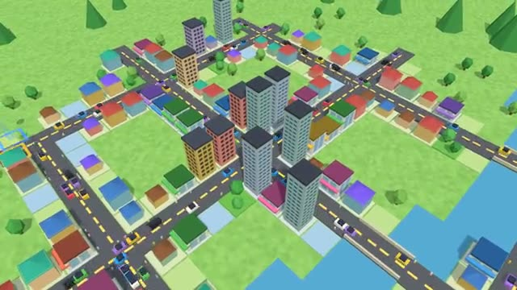

# City Together

Build a little town together. Watch it grow. A multiplayer starter game from [Multiplayer Agent](https://multiplayeragent.com): 3D, co-op, 1–8 players, with AI mayors that build beside you.

## How it plays

Lay roads, then zone homes, shops and parks next to them. Homes fill with people, shops bring jobs, and taxes pay for more. Grow from a hamlet to a city, and the town is still there the next time anyone comes back.

**Controls:** Pick a tool and click or drag on the map to build; drag with the hand (or right mouse) to move, wheel or pinch to zoom, Q/E to turn.

## Make it yours in the Game Builder

Open the [Game Builder](https://multiplayeragent.com), choose **Start from a starter game** and pick City Together. It opens as version 1 in your studio, ready to play and publish. Then ask for changes, for example:

- Add a day and night cycle with street lights
- Add factories that make jobs but scare away homes
- Add a mayor's goal each week with a reward

## Run it yourself

1. Get a free publishable key (`pk_…`) at [multiplayeragent.com](https://multiplayeragent.com).
2. In `index.html`, put it in place of `pk_REPLACE_ME` in the `MP_CONNECT` block.
3. Serve the folder (for example `npx serve`) and open it. The 3D engine loads as a module, which browsers block from a file on disk.

Without a key it still runs, offline with the AI mayors.

## How it is built

- One `index.html` plus three.js in `libs/`. The comment at the top of the script maps the code and explains the multiplayer.
- The whole town is one string, a letter per tile (`.` grass, `r` road, `a`–`d` homes, `e`–`h` shops, `p` park…), so the map, saving and syncing are all the same few lines.
- **World memory:** The town is remembered by the players who built it: whoever comes back first brings it back for everyone.
- **Host-run rules:** The host's browser checks every build, grows the town and keeps the shared money; if it leaves, the next player takes over.
- **Bots:** AI mayors lay streets and zone lots until enough people join.
- **Leaderboard:** The biggest town each player has helped build.
- **Live ops:** Speed up growth (`growth`) or raise taxes (`taxes`) for an event without touching the code; running events show at the top right.
- `?attract` runs it offline with AI mayors only. The preview video is recorded from it.

## License

MIT. three.js in `libs/` is MIT too (Copyright 2010-2024 three.js authors).
